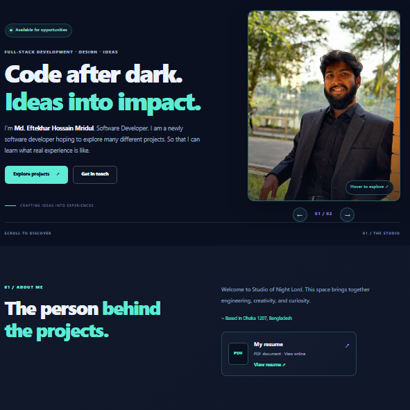
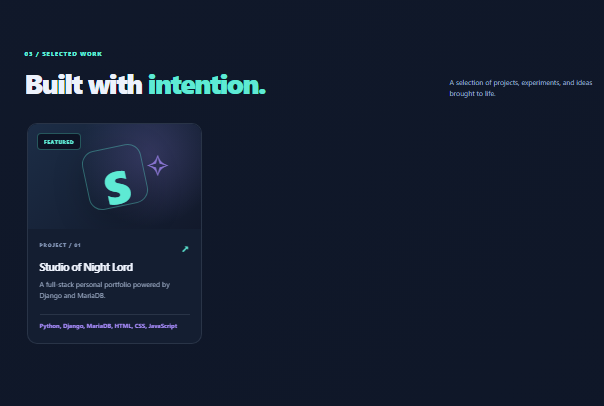
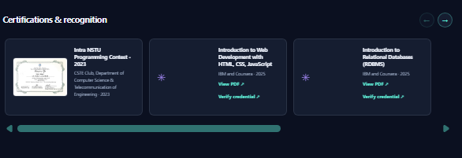
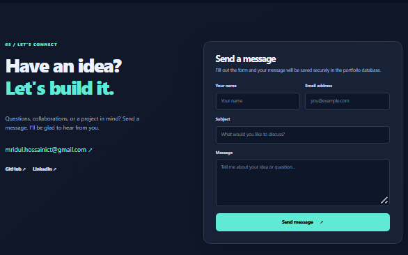

# Studio of Night Lord

A full-stack personal portfolio website built with Django to showcase projects, technical skills, education, experience, certifications, and professional achievements. The interface features a dark visual identity, responsive layouts, interactive portrait transitions, horizontal content galleries, and scroll-triggered animations.

**Live website:** https://studio-of-night-lord.onrender.com  
**Source code:** https://github.com/e-h-mridul/studio-of-night-lord

## Features

- Responsive portfolio homepage with an interactive two-photo portrait carousel.
- Repeatable scroll-reveal animations and smooth horizontal project and certification galleries.
- Project cards with dedicated project detail pages.
- Django Admin content management for profile information, skills, projects, education, experience, certifications, and social links.
- Certificate images and PDF documents.
- Résumé preview in the browser.
- Contact form with messages stored in the database.
- Cloudinary media storage in production.
- Separate local development and production configurations.

## Screenshots

### Homepage and Portrait Carousel


### Project and Certification Galleries



### Contact Section


## Technology Stack

**Frontend**
- HTML5
- CSS3
- Vanilla JavaScript

**Backend**
- Python 3.12
- Django 5.2

**Database**
- MariaDB for local development
- PostgreSQL (Neon) for production

**Media and deployment**
- Cloudinary for production images and PDF documents
- WhiteNoise for production static files
- Gunicorn as the production WSGI server
- Render for application hosting
- Git and GitHub for version control

## Project Structure

```text
studio-of-night-lord/
├── config/
│   ├── settings.py
│   ├── settings_production.py
│   ├── urls.py
│   └── wsgi.py
├── docs/
│   └── screenshots/
│       |── certificates.png
│       ├── contact.png
│       |── homepage.png
|       └── projects.png
├── portfolio/
│   ├── migrations/
│   ├── static/
│   │   └── portfolio/
│   │       ├── css/
│   │       └── js/
│   ├── templates/
│   │   └── portfolio/
│   ├── models.py
│   ├── storage.py
│   ├── views.py
│   └── urls.py
├── manage.py
├── requirements.txt
└── requirements-production.txt
```

The local working directory may retain the name `midnight-studio/`. The diagram above uses the public repository name, which is also the directory created when cloning the repository.

## Local Development

### Prerequisites

- Python 3.12
- MariaDB or a compatible MySQL server
- Git

### 1. Clone the repository

```bash
git clone https://github.com/e-h-mridul/studio-of-night-lord.git
cd studio-of-night-lord
```

### 2. Create and activate a virtual environment

On Windows using Git Bash:

```bash
python -m venv .venv
source .venv/Scripts/activate
```

### 3. Install dependencies

```bash
python -m pip install -r requirements.txt
```

### 4. Create the local database and database user

Start your local MariaDB server, then open phpMyAdmin or a MariaDB client using an administrative account.

For a fresh local installation, execute the following SQL. Replace the example password with a strong, private password.

```sql
CREATE DATABASE studio_night_lord_db
    CHARACTER SET utf8mb4
    COLLATE utf8mb4_unicode_ci;

CREATE USER 'studio_portfolio'@'127.0.0.1'
    IDENTIFIED BY 'replace-with-a-strong-local-password';

GRANT ALL PRIVILEGES ON studio_night_lord_db.*
    TO 'studio_portfolio'@'127.0.0.1';

FLUSH PRIVILEGES;
```

Run these creation statements only when setting up a fresh database and user. If they already exist, reuse the existing configuration rather than recreating them.

### 5. Configure local environment variables

Create a `.env` file in the project root:

```dotenv
STUDIO_SECRET_KEY=replace-with-your-private-django-secret
STUDIO_DB_PASSWORD=your-local-database-password
```

Generate a private Django secret key locally with:

```bash
python -c "from django.core.management.utils import get_random_secret_key; print(get_random_secret_key())"
```

Copy the generated value into your local `.env` file. Never publish the actual secret key or database password.

The local Django configuration uses:

| Setting | Value |
|---|---|
| Database name | `studio_night_lord_db` |
| Database user | `studio_portfolio` |
| Database host | `127.0.0.1` |
| Database port | `3306` |
| Character set | `utf8mb4` |

### 6. Apply database migrations

```bash
python manage.py migrate
```

### 7. Create an administrator account (optional)

```bash
python manage.py createsuperuser
```

### 8. Run the development server

```bash
python manage.py runserver
```

Open http://127.0.0.1:8000/ in your browser.

## Production Deployment

The production configuration uses:

- Render for Django application hosting.
- Neon PostgreSQL for the production database.
- Cloudinary for uploaded images and PDF documents.
- WhiteNoise for static files.
- Gunicorn as the WSGI server.

Production settings are maintained separately in `config/settings_production.py`.

Configure these variables through the hosting provider's environment-variable settings:

- `DJANGO_SETTINGS_MODULE`
- `STUDIO_SECRET_KEY`
- `DJANGO_ALLOWED_HOSTS`
- `CSRF_TRUSTED_ORIGINS`
- `DATABASE_URL`
- `CLOUDINARY_CLOUD_NAME`
- `CLOUDINARY_API_KEY`
- `CLOUDINARY_API_SECRET`

Do not commit production credentials, database connection strings, or API secrets to GitHub.

## Testing and Verification

### Django checks

Check the local project configuration:

```bash
python manage.py check
```

Check model and migration consistency:

```bash
python manage.py makemigrations --check --dry-run
```

Run Django's automated test runner:

```bash
python manage.py test
```

### Manual functional verification

The deployed application has been manually checked for:

- Homepage styling, animations, and responsive layout.
- Portrait carousel interactions.
- Project cards and project detail pages.
- Skills and certification displays.
- Résumé preview and certificate PDF links.
- Contact form submission and message persistence in Django Admin.
- Production database connectivity.

These are manual functional checks; they should not be interpreted as a claim that a comprehensive automated test suite exists.

## Security and Data Protection

- `.env` files, virtual environments, local databases, and backup files are excluded from version control.
- Uploaded personal media and database backups are stored separately from source code.
- Local development and production database configurations are maintained separately.
- Django migrations are used to manage database schema changes.
- Production secrets are stored in the hosting provider's environment variables.

Never commit real credentials, private contact-message exports, personal résumé files, or database backups.

## License

No license has been specified. All rights are reserved by default unless a license is added.
